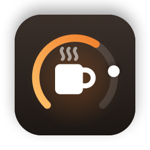

  

# EmberBar

A personal macOS menu bar app for controlling an [Ember mug](https://ember.com/).

EmberBar is a fork of [EmberMate](https://github.com/matthewnitschke/EmberMate) by Matthew Nitschke, released under the MIT license (see `LICENSE`).

## Changes compared to EmberMate

- The °C/°F choice is stored in the app and pushed to the mug, so it no longer falls back to °F.
- Redesigned menu bar window: temperature ring, mug status, power button, +/− controls and preset cards.
- Heating can be turned off, by hand or automatically a set time after filling the mug.
- Estimates: time until the drink reaches its target, how much is left in the mug, and cups and millilitres drunk today (optional, stored only on this Mac).
- Mug settings: rename the mug, LED colour swatches with brightness, capacity, model and firmware details.
- Notifications arrive with banner and sound, including "fully charged" and "heating stopped".
- Translated into Dutch, French, German, Spanish, Italian, Portuguese, Polish, Swedish, Danish, Norwegian, Finnish and Japanese.
- New app icon, no update checks against the upstream project, and fixes for several crashes in the Bluetooth code.

Protocol details come from the reverse-engineering work in [orlopau/ember-mug](https://github.com/orlopau/ember-mug) and [sopelj/python-ember-mug](https://github.com/sopelj/python-ember-mug).

## Building

Open `EmberBar.xcodeproj` in Xcode and run the `EmberBar` scheme, or archive it via Product → Archive.
